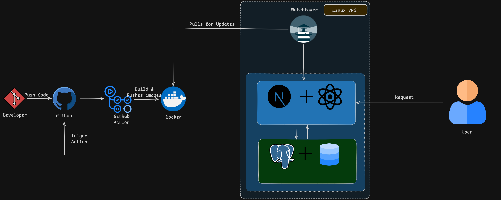

# 🚀 Simple Next.js Full-Stack App | DevOps CI/CD Pipeline

A complete three-tier web architecture demonstrating modern full-stack development and automated Continuous Integration/Continuous Deployment (CI/CD). 

This project was built from scratch to showcase the seamless integration of a Next.js frontend, a PostgreSQL database, and a fully containerized deployment pipeline running on an Ubuntu VPS.

## 🏗️ Architecture & Tech Stack

### Full-Stack Development
* **Frontend:** Next.js (App Router), React, TypeScript, Tailwind CSS
* **Backend:** Next.js API Routes, Node.js
* **Database & ORM:** PostgreSQL (`postgres:16-alpine`), Prisma ORM

### DevOps & Infrastructure
* **Containerization:** Docker, Multi-stage `Dockerfile`
* **Networking:** Secure, isolated private Docker networks (`next-net`)
* **CI/CD Pipeline:** GitHub Actions (Continuous Integration), Watchtower (Continuous Deployment)
* **Hosting:** Remote Ubuntu Linux VPS
* **Registry:** Docker Hub (`sajithlakmal2004`)

---

## ⚙️ How the CI/CD Pipeline Works

This repository is configured for completely automated, zero-touch deployments.

1. **Commit & Push:** Developer pushes frontend or backend code changes to the `main` branch on GitHub.
2. **Automated Build (CI):** GitHub Actions triggers automatically, building a highly optimized Next.js Docker image using a custom multi-stage `Dockerfile`.
3. **Registry Push:** The completed image is securely pushed to Docker Hub (`sajithlakmal2004/simple-next-app:latest`).
4. **Automated Deployment (CD):** Watchtower, running continuously on the production Ubuntu VPS, detects the new image, pulls it, gracefully shuts down the old container, and spins up the new one—all within 60 seconds.

---

## 🔒 Security & Optimization Highlights

* **Database Isolation:** The PostgreSQL database is attached exclusively to a custom Docker bridge network. It does not expose port 5432 to the public internet, preventing external intrusion.
* **Multi-Stage Builds:** The Dockerfile is optimized to discard dev-dependencies and source code, resulting in a lightweight, production-ready container that boots instantly.
* **Secret Management:** All database URLs and Docker registry credentials are fundamentally isolated using GitHub Actions Secrets and environment variables.

---

## 👨‍💻 About the Developer

**Sajith Lakmal**  
*Information Technology Undergraduate at University of Moratuwa*  
Passionate about designing resilient database architectures, provisioning Linux infrastructure, and building scalable full-stack web applications. 

* **Focus Areas:** DevOps Engineering, Linux System Administration, Docker Containerization, Cloud Security, and Full-Stack Development (Next.js/React/Go).
* **Let's Connect:** WhatsApp - 0743341562

## 🗺️ System Architecture

